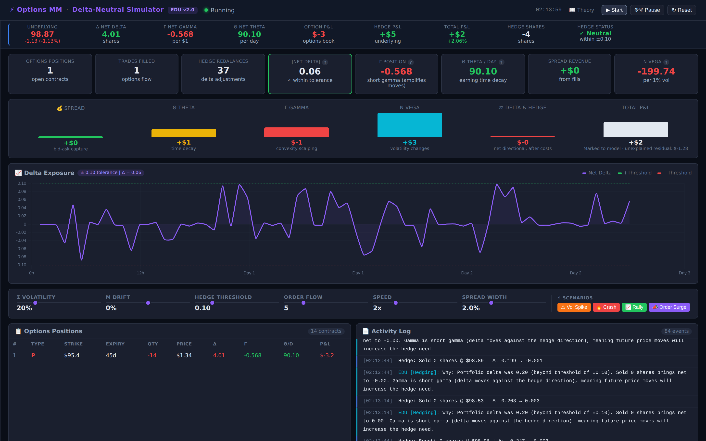
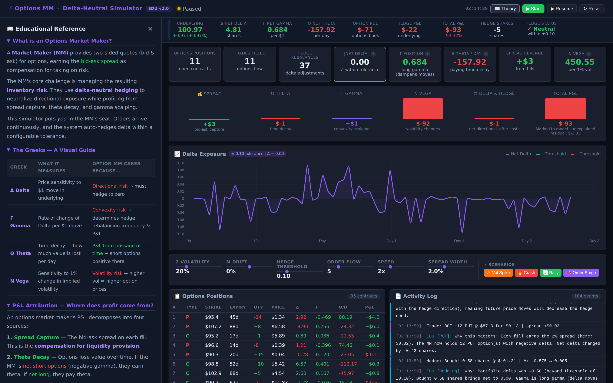
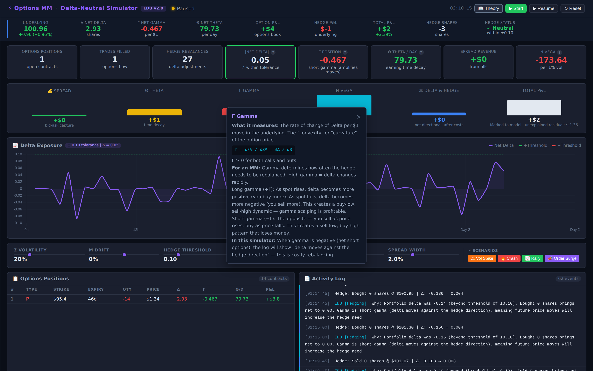
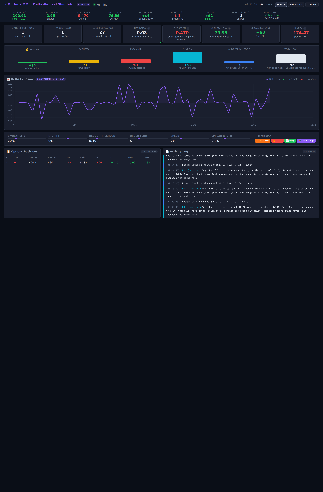

<div align="center">

# Options Market Maker

**A delta-neutral options market-making simulator, in one HTML file.**

Quote into synthetic options flow, price every contract with Black-Scholes, hedge delta automatically, and watch the book's P&L split into spread, theta, gamma, vega and directional components that reconcile to the true marked-to-model total.

[](index.html)
[](https://www.chartjs.org/)
[](LICENSE)
[](https://github.com/mutima89/options-mm-simulator/commits)

[Overview](#overview) · [Screenshots](#screenshots) · [Quick start](#quick-start) · [The model](#the-model) · [P&L attribution](#pl-attribution) · [Learning path](#suggested-learning-path)



</div>

---

## Overview

| | |
|---|---|
| **Order flow** | Poisson-arriving client orders: calls or puts, buy or sell, strikes 80–120% of spot, 1–90 days to expiry, 1–15 contracts |
| **Pricing** | Black-Scholes prices and Greeks (Δ, Γ, Θ, ν) for every position and the whole book |
| **Hedging** | Rebalances with the underlying whenever net delta leaves a tolerance band; each hedge share costs $0.01 |
| **Market** | The underlying follows geometric Brownian motion in 15-minute steps with adjustable volatility and drift |
| **Attribution** | A waterfall splits P&L into spread, theta, gamma, vega and delta-and-hedge, and shows what the Greeks leave unexplained |
| **Scenarios** | Vol Spike, Crash, Rally and Order Surge buttons stress the book on demand |
| **Teaching layer** | Theory panel, click-to-explain Greeks, and an activity log that explains every fill and hedge |

No build step, no backend, no account.

## Screenshots

| Theory panel | Greek explainer |
|:---:|:---:|
|  |  |

<details>
<summary>Full page</summary>



</details>

## Quick start

1. Download or clone the repository.
2. Open `index.html` in a modern browser.
3. Press **Start**.

The page loads Chart.js from a CDN, so it needs an internet connection the first time.

### Controls

| Control | Range | Effect |
|---|---|---|
| Volatility σ | 5–80% | Volatility of the underlying and of Black-Scholes pricing |
| Drift μ | −20% to +20% | Annual expected return of the underlying |
| Hedge threshold | 0.01–0.50 | Net delta (in shares) tolerated before rebalancing |
| Order flow | 1–20 | Expected client orders per trading day |
| Speed | 1×–5× | One 15-minute step every 250 ms at 2×, 100 ms at 5× |
| Spread width | 0.5–5.0% | Bid-ask spread as a percentage of theoretical value |

## The model

- **Underlying:** `dS = S (μ dt + σ √dt Z)` with 15-minute steps (26 per trading day, 252 days per year), risk-free rate 5%.
- **Pricing:** Black-Scholes for European calls and puts. The normal CDF uses the Abramowitz–Stegun erf approximation evaluated at x/√2, accurate to about 1e-7.
- **Fills:** the market maker buys at theoretical minus half the spread and sells at theoretical plus half; the difference is booked as spread revenue.
- **Expiry:** positions settle at intrinsic value.
- **Contracts:** one contract is one share of underlying (no ×100 multiplier), so Greeks read directly in shares and dollars.

## P&L attribution

```text
Total P&L = Spread + Theta + Gamma + Vega + (Option delta P&L + Hedge P&L − Hedge costs) + Residual
```

**Total P&L** is the book's real P&L: open options marked to Black-Scholes, realized expiries, and the hedge position after costs. Each component is accumulated step by step from the Greeks:

| Bucket | Per step | Sign for a typical short-options book |
|---|---|---|
| Spread | Fill price versus theoretical value | Positive |
| Theta | Θ × dt | Positive |
| Gamma | ½ Γ × dS² | Negative |
| Vega | ν × dσ (averaged across the change) | Depends on the vol move |
| Delta & Hedge | Δ × dS plus hedge mark-to-market, minus $0.01/share | Near zero when well hedged |
| Residual | Total minus the buckets above | Small; grows with large jumps |

The residual is shown under the Total bar, so you can see where the Taylor expansion stops being a good description, for example after an 8% crash.

## Scenarios

| Button | Effect |
|---|---|
| Vol Spike | σ jumps to 60% for about 2 seconds, then reverts |
| Crash | Spot falls 8% instantly |
| Rally | Spot rises 6% instantly |
| Order Surge | Order flow jumps to 20 per day for about 5 seconds |

## Suggested learning path

1. Start with σ = 15% and a wide threshold (0.20); read the waterfall as positions build.
2. Tighten the threshold to 0.05: more rebalancing, higher hedge costs.
3. Hit **Vol Spike** and watch the Vega bar; hit **Crash** and watch Gamma and the residual.
4. Raise order flow and see how fast the book's Greeks accumulate.
5. Open the **Theory** panel or click any Greek for its formula and market-making context.

Extended notes are in [`docs/theory.md`](docs/theory.md).

## Project structure

```text
options-mm-simulator/
├── index.html                         The complete simulator
├── docs/theory.md                     Extended theory reference
├── docs/screenshots/
├── scripts/capture_screenshots.py     Rebuilds the README screenshots (headless Chromium)
├── .github/workflows/screenshots.yml  Runs that script on GitHub Actions
└── LICENSE
```

## Known limitations

- Single underlying, flat volatility (no smile or term structure), European exercise only.
- Hedging is delta-only; vega and gamma are left open.
- One order can arrive per 15-minute step, which caps very high order-flow settings.

## License

MIT — see [LICENSE](LICENSE). Educational tool; all market data is synthetic and nothing here is financial advice.
